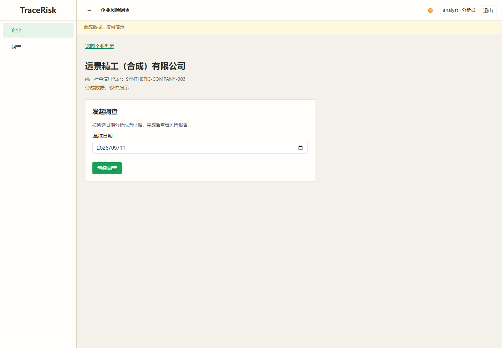
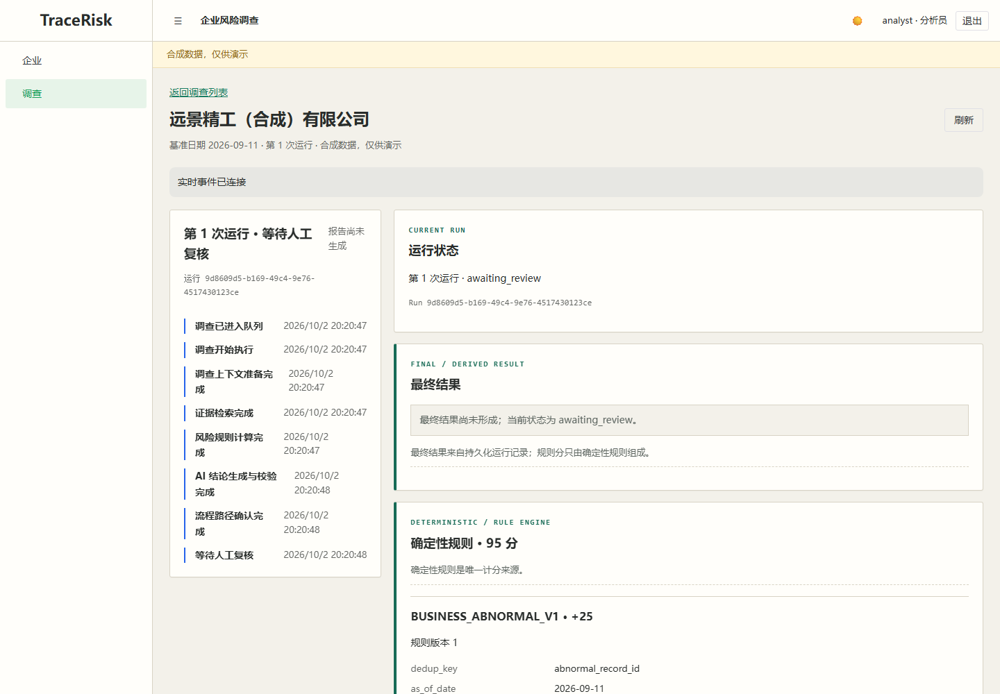
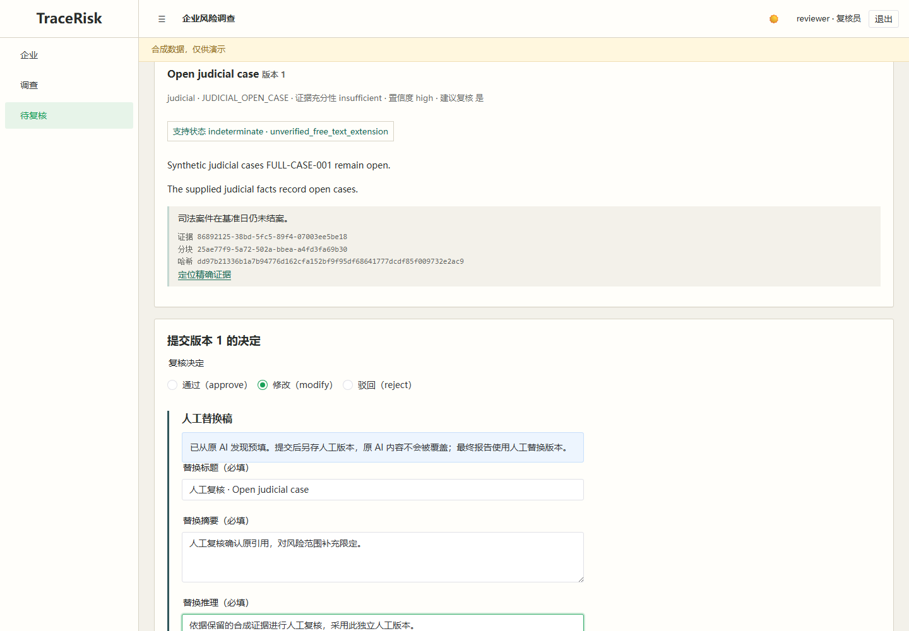
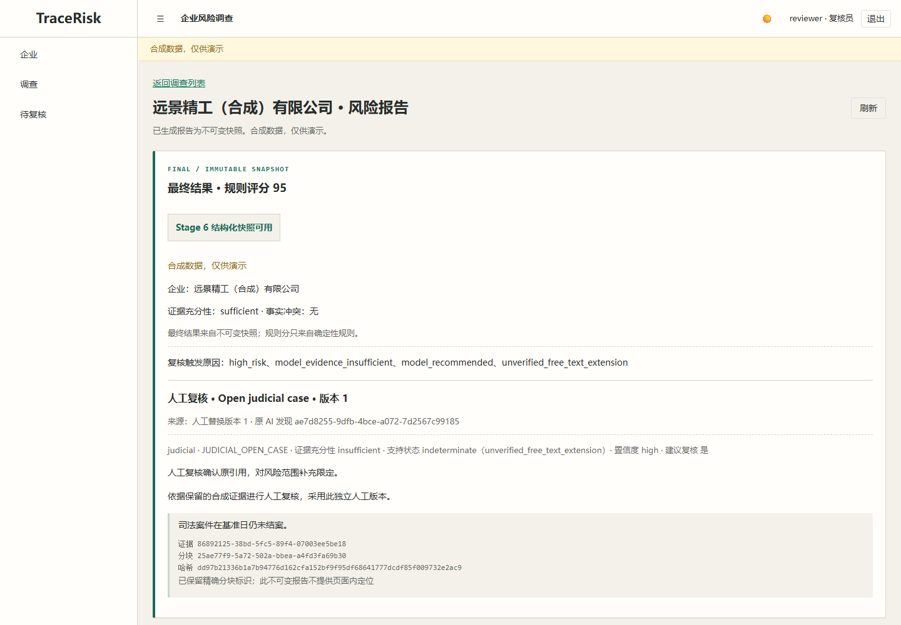

# TraceRisk v3

可追溯的企业风险调查演示：确定性规则评分、冻结检索证据、结构化 AI 发现、人工复核，以及不可变报告。Web 使用 Vue 3 / Naive UI，API 使用 FastAPI，后台以一个 combined worker 管理 Outbox 与 Procrastinate，业务数据、队列和 LangGraph checkpoint 保存在 PostgreSQL / pgvector。

> [!IMPORTANT]
> 合成数据，仅供演示。当前验收使用 Mock 生成与 Fake embedding，无真实模型质量、吞吐、延迟或成本结论。两次本地 Vite/API/worker/PostgreSQL E2E 各覆盖 8/8 路径；2026-10-08 hosted CI、fresh-clone Docker 与五分钟演练均已通过，详情见[当前验收状态](docs/acceptance.md)。

## 看项目

| 企业详情 | 调查时间线 |
|---|---|
|  |  |
| 人工修改复核 | 不可变风险报告 |
|  |  |

[当前验收状态](docs/acceptance.md) · [五分钟演示](docs/demo-script.md) · [架构与时序](docs/design/system-architecture.md) · [面试讲解](docs/interview-notes.md) · [简历证据](docs/resume-bullets.md)

## 本地启动（PowerShell，仓库根目录）

需要 Python 3.12、uv 0.10.8、Node 24、pnpm 11.13.1，以及 Docker Compose 中的 PostgreSQL 17 / pgvector。依赖以 [API lockfile](apps/api/uv.lock) 和 [Web lockfile](apps/web/pnpm-lock.yaml) 为准。安装依赖：

```powershell
uv sync --frozen --directory apps/api
corepack prepare pnpm@11.13.1 --activate
pnpm --dir apps/web install --frozen-lockfile
```

首次复制 `.env.example` 为私有 `.env`，设置本地数据库连接和不少于 32 字符的 `JWT_SECRET`。保留 `.env` 在本机；演示、日志和截图不展示密钥。演示账号是 `analyst`、`reviewer`、`admin`；本地初始密码的来源为 [账号种子](apps/api/src/tracerisk/auth/seed.py)，本文不复制凭据。

每个 API/worker 终端先设置同一演示环境：

```powershell
$env:PYTHONPATH = 'apps/api/src;.'
$env:POSTGRES_DB = 'tracerisk_demo'
$env:MODEL_ADAPTER = 'mock'
$env:EMBEDDING_PROVIDER = 'fake'
$env:EMBEDDING_MODEL = 'fake-sha256-v1'
$env:LANGSMITH_TRACING = 'false'
$env:LANGCHAIN_TRACING_V2 = 'false'
$env:WORKER_HEALTH_FILE = Join-Path (Get-Location) 'worker-health.json'
```

首次运行：只初始化 `tracerisk_demo`，不迁移保留的 `tracerisk`，不重建其 BGE 索引。

```powershell
docker compose up -d --wait --wait-timeout 120 postgres
apps/api/.venv/Scripts/python.exe scripts/database_lifecycle.py verify-retained
apps/api/.venv/Scripts/python.exe scripts/database_lifecycle.py bootstrap-demo
apps/api/.venv/Scripts/python.exe scripts/database_lifecycle.py verify-target --target tracerisk_demo
```

`bootstrap-demo` 按顺序初始化 Alembic、队列、checkpoint、账号、合成目录及 Fake 索引。已有完整目标每日只执行 `verify-target`，不要重复首次初始化。三个终端分别启动 API、worker 和 Web：

```powershell
apps/api/.venv/Scripts/python.exe -B scripts/run_api.py
apps/api/.venv/Scripts/python.exe -m tracerisk.workflows.service
pnpm --dir apps/web dev
```

Windows API 包装器使用 psycopg 所需的 Selector event loop；其他平台可从 `apps/api` 执行 `uv run uvicorn tracerisk.main:app --host 127.0.0.1 --port 8000`。Web 为 `http://127.0.0.1:3200`，API 文档为 `http://127.0.0.1:8000/docs`。健康检查：

```powershell
Invoke-RestMethod http://127.0.0.1:8000/health
apps/api/.venv/Scripts/python.exe -m tracerisk.workflows.health --check
```

本地拓扑已通过[两次八路径 E2E](docs/evaluation/e2e-results.json)。当前 Git、hosted CI、全新 Docker 与演练结论统一见[当前验收状态](docs/acceptance.md)；非 Windows 本地启动命令未复验。

## Docker 启动边界

[Compose 指南](docs/operations/docker-compose.md) 提供首次和每日命令。首次在 PostgreSQL 健康后：

```powershell
docker compose build api web
docker compose run --rm --no-deps api python scripts/database_lifecycle.py verify-retained
docker compose run --rm --no-deps api python scripts/database_lifecycle.py bootstrap-demo
docker compose run --rm --no-deps api python scripts/database_lifecycle.py verify-target --target tracerisk_demo
docker compose up -d --wait --wait-timeout 180 api worker web
docker compose ps
```

Docker Web 默认端口 `8080`。初始化、隔离边界和当前 fresh-clone 验收结果见 [Compose 指南](docs/operations/docker-compose.md)与[当前验收状态](docs/acceptance.md)。

停止应用使用 `docker compose stop api worker web`，保留 `tracerisk_postgres_data`。临时 E2E 数据库只使用记录所有权的 `scripts/seed_e2e.py drop --record <ownership.json>` 或 lifecycle `drop-owned` 清理；不要删除保留数据库或命名卷。本地开发进程用各终端 Ctrl+C 停止。

## 评测与可复现演示

> [!WARNING]
> 以下评测命令用于仓库维护者复验，要求本机保留数据库 `tracerisk` 与 Stage 6 冻结基线一致（Alembic `0011`、31 张表、879 行及原 BGE 索引）。全新安装只创建 `tracerisk_demo`，不能直接运行这个带保留基线完整性门禁的脚本；请按上文手动启动演示，并阅读已记录的评测/E2E 结果。

```powershell
apps/api/.venv/Scripts/python.exe scripts/run_evaluation.py
```

评测命令自建并清理 `tracerisk_eval_*`，更新 `docs/evaluation/results.json` / `.md`。完整 E2E 需要独立 `tracerisk_e2e_*`、API/Web、正常与非法引用 worker 以及 Playwright；不启用 trace/video，不发布认证原始日志。历史执行细节见[检查清单](docs/evaluation/e2e-checklist.md)，当前发布验收见[当前验收状态](docs/acceptance.md)。

| 当前固定合成样本 / Mock-Fake | 分子 / 分母 |
|---|---:|
| 规则精确匹配 | 13 / 13 |
| 宏平均 Recall@5 | 16.0 / 16 |
| 持久化引用合法 | 2 / 2 |
| 最终发现证据覆盖 | 1 / 1 |
| 结构化输出成功 | 2 / 2 |

[机器结果及公式](docs/evaluation/results.json) / [人读结果](docs/evaluation/results.md)。Fake Recall@5 是小型合成候选池的管线回归，真实模型 `not_run`。质量门禁由 [CI 配置](.github/workflows/ci.yml) 使用 Mock/Fake；hosted 执行状态与提交链接只在[当前验收状态](docs/acceptance.md)更新。

## 设计与限制

评分完全来自规则，AI 和人工替换不改规则分数；缺证据的零分不表示企业安全。引用必须属于当前 Run 的冻结 chunk，核对内容哈希与连续摘录，再通过支持性校验。人工修改追加版本并保留原 AI；报告保存最终发现、原 AI、决定、证据、规则和版本。SSE 从持久事件恢复，前端去重及失败轮询；不是内存消息总线。

项目未验证真实外部企业数据接入、真实模型质量或生产部署。更多边界及代码证据见[当前验收状态](docs/acceptance.md)和[面试讲解](docs/interview-notes.md)。
