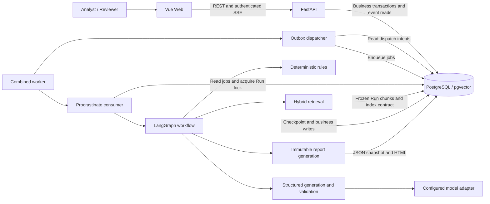
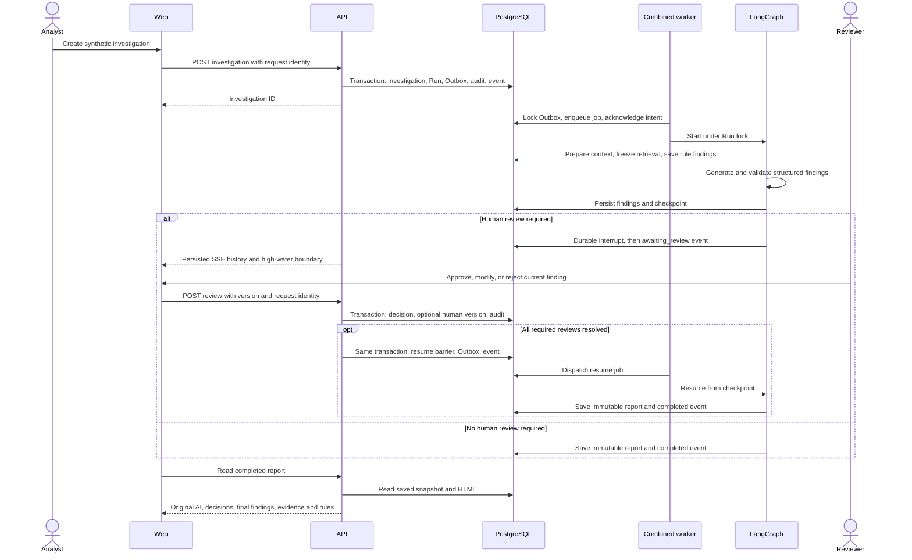

# TraceRisk v3 实现架构

## 组件

本地验收 Web 是 Vite（3200），API 是 8000；配置的 Docker Web 是 Nginx（8080）。它们是两种入口，不是同时部署的两个产品服务。演示 adapter 为 Mock，embedding 为 Fake；真实 HTTP adapter 代码存在，真实模型没有验收。没有外部 broker、Redis 或云服务节点。

## 调查、复核与恢复

节点与边对应 [调查 service](../../apps/api/src/tracerisk/investigations/service.py)、[Outbox](../../apps/api/src/tracerisk/workflows/outbox.py)、[执行图](../../apps/api/src/tracerisk/workflows/spike_graph.py)、[复核](../../apps/api/src/tracerisk/reviews/service.py)、[报告](../../apps/api/src/tracerisk/reports/service.py)、[SSE](../../apps/api/src/tracerisk/workflows/sse.py)。Outbox 入队和标记不是跨连接原子提交：可重复投递，依靠锁、唯一约束和重放检查恢复。

## 数据与事务边界

| 数据 | 写入者和边界 |
|---|---|
| Investigation / current Run | API 显式事务；Run、事件和 Outbox 同时保存 |
| Outbox / Procrastinate job | 业务保存意图，dispatcher 持锁投递和确认；可重投 |
| 检索快照 / 规则 / AI | worker 节点事务；引用限于当前 Run 冻结集合 |
| Checkpoint | PostgreSQL saver；不是业务 Session 的同一事务，中断持久后才发布待复核 |
| 人工版本 / 决定 / 恢复屏障 | 复核同一事务；当前 Run/版本，禁止创建者自审 |
| Report / 完成事件 | 报告同一事务；每 Run 一个不可变快照 |
| SSE | 独立短读 Session；历史、水位和认证恢复，不使用流生命周期长事务 |

另见 [领域模型](domain-model.md)、[证据契约](evidence-contract.md)、[状态机](workflow-state-machine.md)。

## 故障恢复与隔离

队列重试、失联任务恢复、Run advisory lock 和节点完成记录共同处理故障。非法引用、索引不就绪等拒绝生成可信报告。重复复核重放旧响应，全部发现处理完才恢复，重复报告复用已有快照。见 [supervisor](../../apps/api/src/tracerisk/workflows/service.py)、[worker](../../apps/api/src/tracerisk/workflows/worker.py)。

保留 `tracerisk` / BGE 索引只读；演示用 `tracerisk_demo`，评测/E2E 用生成的 `tracerisk_eval_*` / `tracerisk_e2e_*`。生命周期检查实际连接目标与所有权，清理不删除 `tracerisk_postgres_data`。迁移、队列、checkpoint、种子和 Fake 索引初始化先于应用启动。见 [lifecycle](../../scripts/database_lifecycle.py)、[操作指南](../operations/docker-compose.md)。

密钥只从本地 `.env` / 环境载入，不进入截图和交付。SSE metadata 使用允许字段；报告 iframe 有 sandbox；认证原始日志与 trace/video 排除。演示用合成企业，CI 不调用真实模型。见 [设置](../../apps/api/src/tracerisk/config.py)、[metadata](../../apps/api/src/tracerisk/workflows/events.py)、[报告 UI](../../apps/web/src/features/reports/ReportPage.vue)。

Docker、hosted CI 和五分钟演练的当前结论见[验收入口](../acceptance.md)；本地 Vite 八路径结果见 [E2E 汇总](../evaluation/e2e-results.json)。
