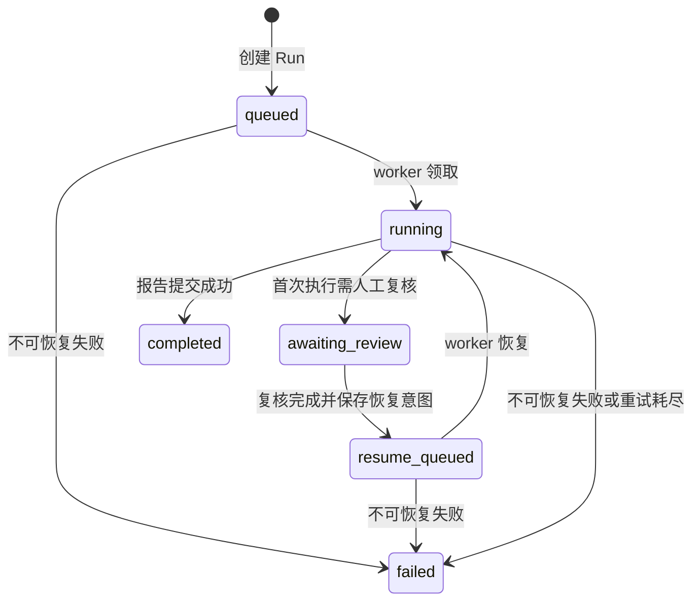

# 工作流状态与重试契约

依据：[实施计划](../../TraceRisk-v3-实施计划.md)第 7～9、14～16 节；已确认决策编号见 [领域模型](domain-model.md)。

## 状态和合法转换

| 当前状态 | 含义 | 允许的下一状态及条件 |
|---|---|---|
| `queued` | 初次任务等待执行 | worker 领取后到 `running`；不可恢复失败到 `failed` |
| `running` | worker 正在初次执行或复核后恢复 | 需要复核到 `awaiting_review`；报告成功提交到 `completed`；不可恢复失败到 `failed` |
| `awaiting_review` | 已持久化中断，等待人工 | 有效复核完成并提交恢复意图后到 `resume_queued`；完成条件见下文 D1 契约 |
| `resume_queued` | 恢复任务等待执行 | worker 领取后到 `running`；不可恢复失败到 `failed` |
| `completed` | 已生成最终报告 | 无，终态 |
| `failed` | 不可恢复错误或重试耗尽 | 无，终态 |

未列出的状态转换全部非法，例如 `queued → completed`、`awaiting_review → completed`、`awaiting_review → failed`、`failed → running`、`completed → queued`。业务状态不得以无条件更新绕过这些限制。

`running` 的路由还受执行阶段限制：初次执行才进入复核中断；有效复核恢复后沿 `resume_review → generate_report` 完成，不再次因原有高风险返回复核。路由依据不是单独一个状态字段。

## 节点及路由

初次执行按 `prepare_context → apply_rules → retrieve_evidence → generate_findings → validate_findings → route_result` 顺序进行。

高风险（60～95 分）、来源不足、证据冲突、模型证据不足或模型建议复核，任一成立则经 `review_interrupt` 等待人工。其余有效结果经 `generate_report` 直接完成。因此中风险本身不强制复核，零分也不保证可以直接生成报告。

单条司法规则是 35 分，不能把它当作高风险演示。阶段 2 若要展示复核，应使用计划已有的另一项复核条件，不能降低 60 分阈值。

## 事务、派发与崩溃边界

创建调查在同一事务内写入 Investigation、Run #1 和初次 DispatchOutbox，提交成功后派发器才可看到意图。API 提交后崩溃不会丢失 Outbox；派发器随后补偿扫描。

派发器先创建队列 Job，再标记 Outbox 已派发。两步之间崩溃允许重新扫描；使用 `queueing_lock=run:{run_id}:{operation}` 抑制重复等待任务，但它不替代数据库结果唯一约束和 worker 有效性校验，也不承诺整个分布式过程恰好执行一次。

worker 开始和提交节点结果前都验证 Run 仍为当前有效 Run。重复投递不能重复提交规则、复核或报告。自动重试沿用 Run 与 thread_id；节点增加 `attempt_count`，不得创建新 Run 或覆写已提交历史结果。

暂时性错误在自动重试期间不先写入 `failed`，因为终态不能恢复。进程崩溃后接管仍为 `running` 的任务需要防止与旧 worker 同时提交；具体接管手段属于阶段 1 Spike 的验证范围，本阶段不假定队列锁已经解决它。

结构化模型输出失败最多重试一次，第二次失败后写入 `failed`，后续队列重投递不得重置这一预算。其他基础设施重试次数由技术 Spike 明确，不擅自赋予无限重试。

## 中断与人工恢复

`review_interrupt` 使用持久化 checkpointer，`thread_id=run_id`；等待不占 worker。中断前的业务写入必须可幂等重放。checkpoint 与业务库状态必须能在崩溃后对账，不能仅依靠内存变量判断等待状态。

有效复核的保存、`awaiting_review → resume_queued` 条件更新与恢复 Outbox 必须作为一致的业务提交处理。有多条结论时，逐条提交有效决定，尚有未处理项则保持 awaiting_review；最后一项提交时才改变状态并创建恢复 Outbox。零条结论但强制复核时，一次有效运行级决定完成复核。

worker 用原 thread_id 恢复到 `resume_review`，不重新生成 AI 结论。报告唯一约束防止重复插入；报告与 `running → completed` 需一致提交，不能把无报告的运行显示为完成。

并发提交不同结论时，应以 Run 为单位串行化“保存决定、检查是否全部处理完、创建恢复意图”，防止两个事务都看不到对方的决定而永久等待。最后一次事务失败应整体回滚，可安全重试；此前已提交的决定保留。

零结论运行级决定记录对证据不足或冲突的人工处理结果及理由，不制造 AI 结论、分数或“未发现风险”结论。不存在可修改的 AI 文本，不能接受针对空结论的修改操作；批准或驳回均保留该决定并完成本轮人工处理，报告仍展示覆盖不足、冲突和空最终 AI 结论集合。全部结论被驳回时同样完成复核，报告保留规则分数和驳回理由。

API 的零结论运行级提交应绑定 Run（如 `/runs/{id}/review`），不能伪造 finding_id 调用普通结论接口；复用现有复核页面和服务。它同样要求 Idempotency-Key，不增加独立恢复按钮或新审批角色。

## 幂等请求与冲突

创建调查、重新调查、提交复核及安排恢复均要求 `Idempotency-Key`。相同用户的重复请求不产生新副作用；幂等结果识别应先于重复执行已失效的状态变更。相同键和相同请求重放原结果，相同键但不同请求返回冲突；这是请求一致性处理，不允许借重复键改写原决定。

不同键再次复核已有决定、版本过期、非当前 Run 或状态不符均拒绝。部分写入不能在拒绝后留下有效复核或额外 Outbox。用户主动重新调查不属于失败恢复；仅当前 Run 为 completed 或 failed 时允许，其他状态返回冲突。创建新 Run、条件切换 current_run_id、写入初次 Outbox 和幂等结果应在同一事务完成；并发请求不得创建两个有效新 Run。

## 五类场景走查记录

本表是规格审阅，不能宣称数据库、worker 或浏览器测试已经通过。

| 场景 | 输入与路径 | 必须观察到的结果 | 审阅状态 |
|---|---|---|---|
| 正常 | 来源均可用、无冲突、有效 AI 结论、无复核触发；`queued → running → completed` | 一份报告；规则和引用可追溯；无虚构复核记录 | 原计划语义一致 |
| 失败 | 同一 Run 连续两次结构化输出失败 | 两次调用记录；Run 为 `failed`；无报告；重复 Job 不重新启动该 Run | 原计划语义一致 |
| 复核 | 60 分或来源不足；持久化中断后重建 worker | `awaiting_review → resume_queued → running → completed`；thread_id 不变；原始 AI 保留 | 通过：全部处理完或零条运行级决定后恢复 |
| 重复复核 | 同一请求重复提交，或不同键再次处理已决定项 | 前者无新副作用；后者冲突；仅一份报告和一次有效恢复意图 | 通过：重复请求不再触发完成判定的副作用 |
| 重新调查 | 已有 Run #1，用户发起新执行 | 新 Run #2、新 thread_id；当前指针切换；旧结果不变 | 通过：仅终态允许，非终态冲突 |

2026-09-10：根据用户确认的 D1、D2 复查五类场景，规格层面各有唯一解释。额外检查两条结论先后提交（第一条仍等待，第二条仅恢复一次）、零结论运行级复核、全部驳回、并发最后复核及非终态重新调查，结果与上述约束一致。阶段 1 还必须实测提交后崩溃、重复派发、并发执行、中断重启和重复恢复。
